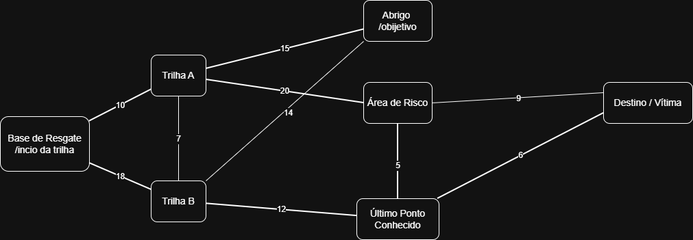

# ATLAS Global — Sistema Inteligente de Rotas para Busca e Resgate

<p align="center">
  <strong>Planejamento estratégico de rotas utilizando Teoria dos Grafos e algoritmos de busca.</strong>
</p>

O **ATLAS Global** é um projeto acadêmico desenvolvido para apoiar o planejamento de rotas em cenários simulados de emergência, desastres naturais e operações de busca e resgate.

A aplicação representa pontos estratégicos como vértices de um grafo e suas conexões como arestas ponderadas. A partir dessa estrutura, utiliza algoritmos de grafos para calcular trajetórias entre bases de apoio, locais de ocorrência e destinos de resgate.

## 🎯 Objetivo do projeto

Desenvolver um sistema de apoio à decisão capaz de calcular e visualizar rotas estratégicas, explorando conceitos de Teoria dos Grafos aplicados a um cenário de busca e resgate.

## ⚙️ Funcionalidades

- **Visualização geográfica:** representação dos pontos estratégicos em um mapa interativo.
- **Cálculo de rotas:** seleção de pontos de apoio, ocorrência e destino.
- **Dijkstra:** busca o caminho de menor custo considerando os pesos das arestas.
- **BFS (Busca em Largura):** identifica caminhos com o menor número de conexões.
- **Autenticação:** cadastro e login de operadores.
- **Persistência de dados:** armazenamento de operadores utilizando SQLite.
- **Dados estruturados:** carregamento dos vértices e conexões por meio de arquivo JSON.

## 🧠 Algoritmos implementados

| Algoritmo | Aplicação | Complexidade |
|---|---|---|
| Dijkstra | Menor custo em grafo ponderado | O((V + E) log V) |
| BFS | Menor número de conexões | O(V + E) |

**Dijkstra:** considera os pesos das conexões para encontrar uma rota de menor custo acumulado.

**BFS:** percorre o grafo por níveis, buscando uma rota com o menor número de arestas.

## 🛠️ Tecnologias utilizadas

| Tecnologia | Aplicação |
|---|---|
| Python | Lógica e processamento |
| Flask | Aplicação web e rotas HTTP |
| SQLite | Banco de dados |
| JSON | Estruturação dos dados do grafo |
| HTML5 e CSS3 | Interface |
| JavaScript | Interatividade |
| Leaflet | Mapa interativo |
| OpenStreetMap | Dados cartográficos |

## 🏗️ Arquitetura do projeto

```text
atlas-global-grafos-main/
│
├── data/
│   └── grafo.json
│
├── docs/
│   ├── assets/
│   ├── E1_Template.md
│   ├── E2_Template.md
│   ├── E3_Template.md
│   └── README.md
│
├── src/
│   ├── algorithms/
│   │   ├── bfs.py
│   │   └── dijkstra.py
│   ├── core/
│   └── io/
│
├── static/
│   └── css/
│
├── templates/
│   ├── cadastro.html
│   ├── index.html
│   └── login.html
│
├── tests/
│   └── test_graph.py
│
├── main.py
└── README.md
```

## 🚀 Como executar o projeto

### 1. Pré-requisitos

- Python instalado.
- Git instalado.

### 2. Clonar o repositório

```bash
git clone https://github.com/GabrielNsZ/Projetos.git
```

### 3. Acessar a pasta do projeto

```bash
cd Projetos/atlas-global-grafos-main
```

### 4. Criar um ambiente virtual

```bash
python -m venv .venv
```

Ativar no Windows:

```bash
.venv\Scripts\activate
```

Ativar no Linux/macOS:

```bash
source .venv/bin/activate
```

### 5. Instalar a dependência

```bash
pip install Flask
```

### 6. Executar a aplicação

```bash
python main.py
```

Acesse no navegador:

```text
http://127.0.0.1:5000
```

Na tela inicial, acesse o cadastro para criar um operador e depois entre com suas credenciais.

## 🗺️ Diagrama do projeto



## 📚 Documentação acadêmica

Os documentos relacionados ao desenvolvimento do projeto estão disponíveis na pasta [`docs/`](docs/).

- [Etapa 1](docs/E1_Template.md)
- [Etapa 2](docs/E2_Template.md)
- [Etapa 3](docs/E3_Template.md)

## 👨‍💻 Desenvolvimento

Projeto acadêmico desenvolvido em equipe para a disciplina de **Teoria dos Grafos**, no curso de Ciência da Computação.

**Orientadora:** Profa. Dra. Andréa Ono Sakai.

## 📌 Status do projeto

Protótipo acadêmico funcional em desenvolvimento, com foco na aplicação prática de algoritmos de grafos e visualização de rotas em cenários simulados de emergência.

---

**ATLAS Global — Transformando teoria dos grafos em soluções para problemas reais.**
